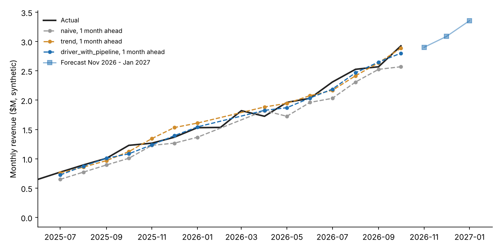

# Usage-Based Revenue Forecasting & Account Scoring

[](https://github.com/rsm-s1bhatt/Usage_Revenue_Forecasting/actions/workflows/ci.yml)

A sales analytics stack for a company whose revenue is **consumption-based**, like an AI inference
platform: customers sign a monthly commit, then pay for the GPU hours they actually use above it.
Built with dbt on DuckDB, Python (pandas, scikit-learn), and GitHub Actions.

It answers the questions a GTM team asks every week:

- **Where is revenue headed?** A driver-based forecast built from commits, usage trends and open pipeline.
- **Why did we beat or miss plan?** Plan versus actual by region, split into the existing base and new logos.
- **Where does growth come from?** A quarterly revenue bridge: new, expansion, contraction, churn, with net and gross retention.
- **Which accounts need attention?** Churn-risk and expansion scores from usage signals, with a reason a rep can read, written to a CRM-ready file.
- **Is revenue profitable?** Gross margin by account, segment and GPU type, because infrastructure cost is real.

> **All data is synthetic.** Real CRM, billing and telemetry data is private, so `scripts/generate_data.py`
> creates it (seeded, so every run is identical). GPU prices and costs are illustrative, not any
> vendor's real rates. The numbers below describe this synthetic business and show the methods work;
> they are not claims about any real company.

## Data

| Source (synthetic) | Rows | What it mimics |
|---|---|---|
| `crm_accounts`, `crm_reps` | 480 accounts, 18 reps | Salesforce accounts (320 customers, 160 prospects), owners, regions, quotas |
| `crm_opportunities`, `crm_opportunity_history` | 954 opportunities | New business, expansion and renewal deals, with stage-by-stage history for point-in-time pipeline |
| `billing_contracts`, `billing_invoices` | 291 contracts, 3,989 invoices | Annual commits with discounts; monthly bill = greater of commit and discounted usage |
| `telemetry_usage_daily`, `telemetry_deployments` | 138,183 usage rows, 5,868 deployments | Daily GPU hours and requests by GPU type (L4, A100, H100, B200), model deployments |
| `plan_revenue_monthly` | 48 rows | 2026 revenue plan by region |

The generator models how usage businesses behave: onboarding ramps, steady growth, step-up
expansions when a new workload goes live (preceded by a burst of deployments and an expansion deal
in the CRM), churn preceded by falling activity, temporary dips that recover, and new GPU types over time.

It also plants **15 known data problems**: 4 duplicate opportunities, 3 opportunities on unknown
accounts, 5 invoices that do not reconcile, and 3 negative usage rows. The data-quality models flag
exactly these 15 and nothing else.

## Pipeline

```
data/raw (CSV)
 └── staging            10 models    clean, type, flag bad CRM rows
      └── intermediate   2 models    monthly usage by GPU, account-quarter revenue
           ├── marts/revenue     fct_revenue_monthly, fct_gross_margin_by_gpu,
           │                     fct_revenue_bridge_quarterly, fct_plan_vs_actual
           ├── marts/sales       fct_pipeline_open, fct_stage_win_rates, fct_rep_performance
           ├── marts/customers   dim_customers  (one trusted row per account: CRM + billing + telemetry)
           ├── marts/ml          fct_account_features_monthly  (point-in-time features and labels)
           └── data_quality      4 checks + dq_summary
                ↓
           Python: scripts/forecast_revenue.py, scripts/score_accounts.py  → schema ml
                ↓
           reporting             rpt_account_priority  (what a rep works from)
```

27 dbt models and 78 data tests. Source contracts (keys, accepted values, relationships), range
checks, and business rules, including:

- `assert_revenue_reconciles_to_invoices`: mart revenue equals invoiced revenue to the cent.
- `assert_committed_plus_overage_equals_revenue`: every month splits exactly into commit and consumption above it.
- `assert_revenue_bridge_balances`: start + new + expansion − contraction − churn = end, every quarter.
- `assert_gpu_margin_reconciles_to_revenue`: revenue allocated to GPU types adds back up to the bill.
- `assert_features_are_point_in_time`: scoring features never use data from after the snapshot.

## Results (synthetic data)

### Revenue forecast

Each live account is forecast as `max(commit in force, usage trend)`, discounted by its segment's
historical churn rate, plus open new-business and expansion deals weighted by **historical stage win
rates** (calibrated from closed deals, instead of the CRM's default probabilities).

Settings were chosen on a **tuning window** (forecast origins Jul 2025 to Jan 2026, `scripts/tune_forecast.py`)
and judged on a later **test window** the tuning never saw (origins Apr to Oct 2026). Every
forecast uses only data available at its origin date, including the pipeline stage each deal was in at the time.

| Test window, MAPE of company revenue | 1 month ahead | 2 months | 3 months | All |
|---|---|---|---|---|
| Naive (last month) | 7.9% | 13.5% | 20.0% | 13.1% |
| Company-level trend | 3.8% | 3.8% | 5.4% | 4.3% |
| Driver-based, existing accounts only | 6.5% | 9.0% | 11.6% | 8.8% |
| **Driver-based with pipeline** | 3.7% | 2.6% | 3.9% | **3.4%** |

Pipeline is what makes the driver-based model work: without it, it misses the step-up expansions.
It beats the trend line by about 1 point overall and at 2 and 3 months, and ties it 1 month out.
Caveat: the generator logs expansion deals in the CRM before usage steps up, so pipeline is a
strong signal here by construction. On real data that has to be re-measured.



### Account scores

Scores are trained on monthly snapshots up to Jan 2026 and tested **out of time** on Apr to Aug 2026
snapshots. Logistic regression is the production model because each score comes with the feature
that pushed it up most, which goes to the rep as the reason. Gradient boosting is trained as a check.

| Out-of-time test | Base rate | ROC AUC | Avg. precision | Top 10% of scores catch |
|---|---|---|---|---|
| Churn or major contraction, logistic | 5.9% | 0.90 | 0.65 | 72% of churners |
| Churn, gradient boosting (check) | 5.9% | 0.90 | 0.75 | 74% |
| Expansion (≥1.4x revenue), logistic | 13.9% | 0.70 | 0.43 | 33% of expanders |
| Expansion, gradient boosting (check) | 13.9% | 0.67 | 0.37 | 29% |

Expansion is harder to call than churn: usage signals lead an expansion only by a month or two, and
some deployment bursts lead nowhere. Scores for all 166 active accounts go to
`exports/account_scores_for_crm.csv` with Salesforce-style custom field names, ready for a CRM import.

### What the marts show

- **Retention:** net revenue retention 113% to 142% a quarter since mid-2025; gross retention 92% to 95%.
- **Plan vs. actual, 2026 to date:** $20.9M actual against a $20.2M plan. The existing base ran
  $1.6M under plan and new logos added $2.4M, so the beat came from new customers, not expansion.
- **Margin:** 32% blended gross margin in Aug to Oct 2026. B200 work runs at 22% and L4 at 45%;
  Enterprise accounts run at 26%, mostly because they carry the deepest discounts (15% to 30%).
- **Pipeline:** the CRM's default stage probabilities (10% to 75%) understate how often deals close
  here (72% to 93% by stage), so the weighted pipeline uses the historical rates.

`rpt_account_priority` turns this into one action per account: retention check-in (top 10% churn
risk), propose a larger commit (top 10% expansion and already paying overage), margin review (under
30% margin), or monitor.

## Run it

```bash
pip install -r requirements.txt
make            # generate data, dbt build, forecast, score, build the report
make tune       # re-run the forecast settings search on the tuning window
```

CI (`.github/workflows/ci.yml`) runs the same steps on every pull request, every push to `main`
and every Monday. Any error-level test failure blocks the pull request. Data-quality checks warn
without blocking. On `main`, the dbt docs site with lineage is published to GitHub Pages.
